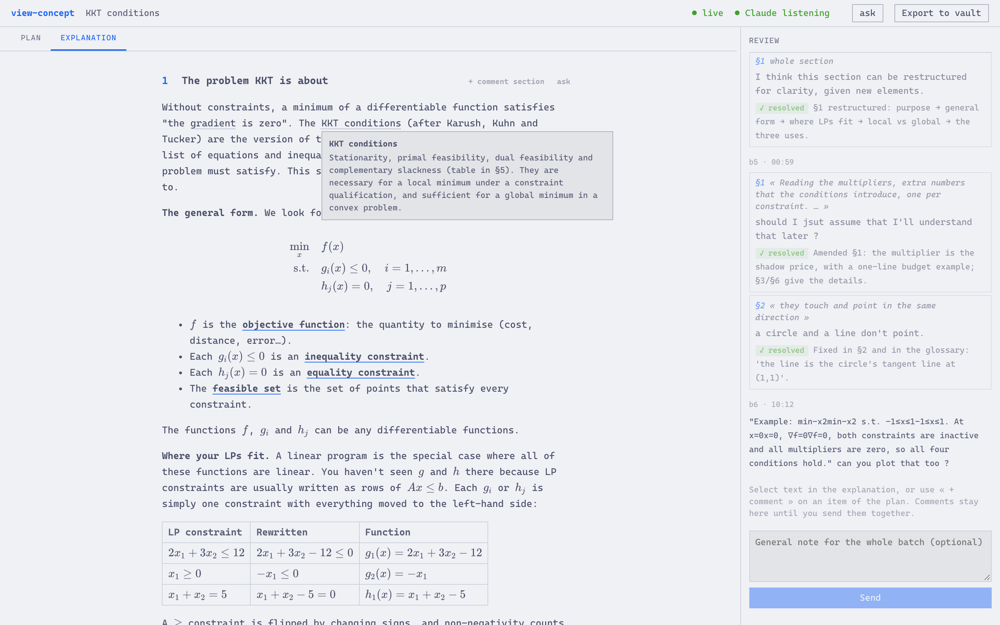
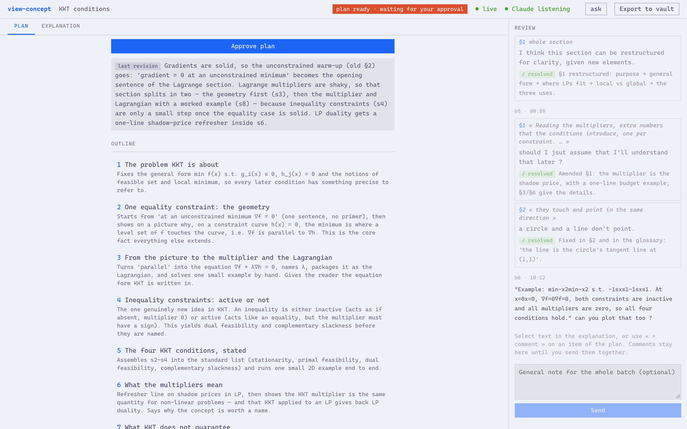
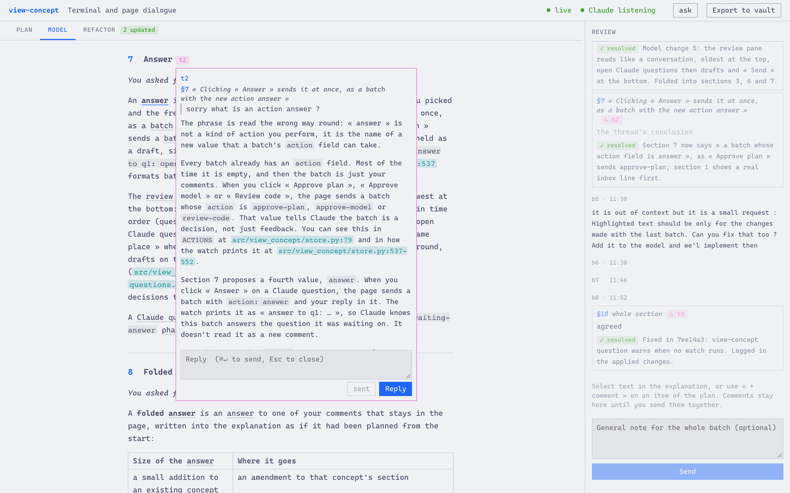
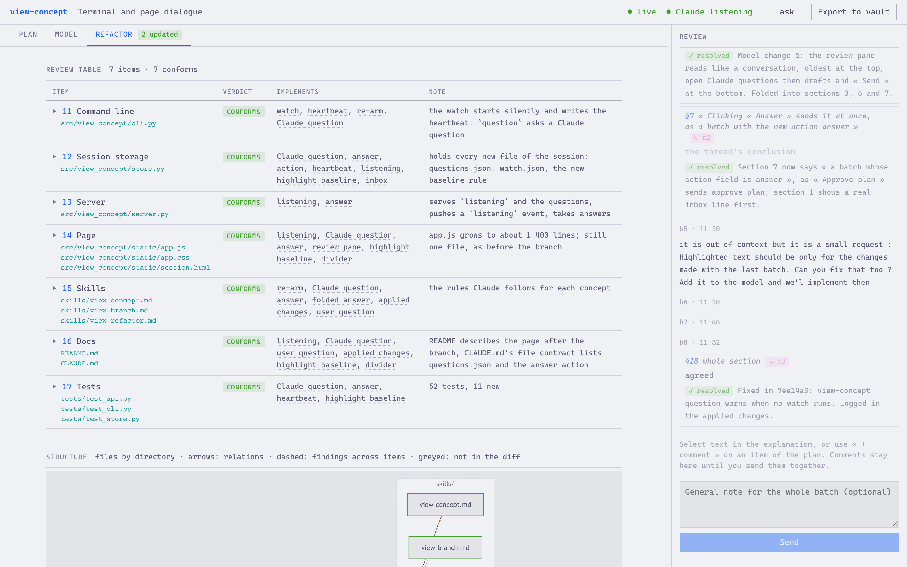

# view-concept

view-concept is a local web page where your coding agent (Claude Code, Codex, Jazz, or any agent that follows a skill and runs shell commands) writes explanations and code reviews, and where you read and comment on them. Each tool is a **skill** (a `SKILL.md` file of instructions the agent loads when you name it): `/view-concept`, `/view-branch`, `/view-refactor`, `/view-docs`, and `/write-readme`, which works without the page.

The agent writes plain files; the **page** renders them in your browser as they are written. You select passages, comment on them, and « Send » posts all your comments at once, as one **comment batch**, to the agent session, which revises the text. One explanation or review, with its files and comments, is a **session**.



## Why a page

In the terminal, a long explanation scrolls away, you cannot point at the sentence you did not understand, and each revision is a new copy to compare with the old one. In the page, the text stays put, comments are anchored to their passage, and a rewritten section highlights what changed.

The page is built around an explanation method, which the `view-concept` skill carries (it started as the **explain-concept** skill). Two of its rules show in the page:

- **The plan comes before the prose.** The **plan** is the outline plus the **lexicon**, the list of every term the explanation uses, with the section that introduces it and its definition. You approve the plan before any paragraph is written.
- **Every term is defined before it is used.** Hovering a lexicon term shows its definition, and a final **vocabulary audit** flags terms that slipped through undefined.

## What a session looks like

You type `/view-concept explain KKT conditions`. The agent opens the page and asks its questions about your level and goal there, at the top of the Plan tab; you answer those you want, then click « Write plan ».

1. **Plan.** The agent writes the outline and the lexicon in the Plan tab. You correct it or click « Approve plan ».
2. **Prose.** The agent writes the sections one by one; the page re-renders as each one lands.
3. **Comments.** Select a passage, « + comment », repeat, then « Send ». The agent edits the sections, replies to each comment, and the words it changed stay highlighted until your next batch.
4. **Side threads.** To discuss a passage before asking for a change, select it and click « ask ». A **side thread** is a separate, read-only conversation forked from the session, so it knows the discussion so far; the session never sees it. (On Claude Code and Codex it forks the real conversation; on any other agent, and in a branch review, it starts from the session's files.)





The page and the terminal talk through the session's files: the page appends each batch to an inbox file, and the agent listens on that file, with `view-concept watch` under a background monitor (Claude Code) or `view-concept wait` called after each turn (every other agent), and revises.

A section can also be written as an HTML file, which the page draws like an artifact on claude.ai: in a frame of its own, in the page's colours, its scripts running. The agent picks it for a visual Markdown and Mermaid cannot draw (a step player, a chart library).

To keep an explanation, « Export to vault » writes it as an Obsidian note, and « Publish » puts it on the web as a read-only page, hosted in a public GitHub repository, at a link you can send (see [`docs/reference.md`](docs/reference.md#publishing)).

## Five skills

| Skill | Use it to |
|---|---|
| `/view-concept` | understand a concept, as described above |
| `/view-branch` | review a branch you are building, concepts first |
| `/view-refactor` | decide what stays in quickly written code, then restructure it |
| `/view-docs` | bring a repo's docs up to date, with no branch to review |
| `/write-readme` | write a folder's README from its code, or bring an existing one up to standard |

A **branch review** (`/view-branch`) first writes the concepts the branch introduces, with their rules; you correct them and approve. The main session only coordinates: separate agents write the concepts, change the code to match them, and check the result. The Code tab lists each changed file with its **verdict** (the decision recorded for that item) and a chart of how the files relate. A concept you change after approval shows as « not implemented yet » until the code catches up. Once the code carries the concepts, « Write docs » has the repo's docs rewritten from them, each folder's after its subfolders' and each README by `/write-readme`: the Doc tab shows each doc the branch concerns, marks what the branch changed in it and underlines the passages the concepts contradict, and you comment on it like any section. A **minor doc**, one the rewrite touched only for a detail with no effect on its meaning, is folded out of the docs the tab asks you to read, with its reason and diff size. Beside each README, the tab shows its **failure indicator**, the share of its passages that failed `/write-readme`'s checks before its edit; a button under the doc titles sends a **rewrite request**, which has the README written again from the code alone and lists under it its **missing facts**, the facts the old one said that the new one no longer says, for you to keep or leave by a comment. « Create PR » then opens the pull request.

To speed the workflow up, the Metrics tab of a branch review shows where its time went, run by run, and compares the repository's reviews by **variant** (`view-concept variant <slug> "writer on sonnet" --model writer=sonnet` names a session's setup and the model of each role).



`/view-docs` reviews docs alone, on a scope you give (a folder, files, or a subject such as « everything about the install »), on a `docs/<slug>` branch of its own. The page shows only the Doc tab. At its first run the agent runs `/write-readme` on each README of the scope and corrects at once, in the other docs, what the code contradicts (a path, a command or a function the repo no longer has). When a branch review of the repo has a model that touches the scope, the agent finds it at its first run, takes it as its **reference model** and flags what that model contradicts; most often there is none, and the docs are measured against the code alone. The agent rewrites the docs on each comment batch, at once, a rewrite request included, and « Create PR » opens the pull request.

`/view-refactor` works the same way on existing code: each item gets a triage verdict (`keep`, `move`, `split`, `merge`, `throw`, `separate-pr`), then the agent applies it on the current branch or splits it into PRs reviewed with `/view-branch`.

`/write-readme benchmark/` writes the `README.md` of one folder, in the terminal, with no page and no session. When the folder has no README it writes a **draft** from the code. When it has one, it always **edits** it: only the passages that fail its checks change, the README's structure and wording kept, and the run report gives the failure indicator. `/write-readme benchmark/ rewrite` asks for a **full rewrite** instead: the README written again from the code alone, without reading the old one, then compared with it to list the missing facts, each with a proposal to keep or leave it; you name the ones that come back. Every sentence passes the **inclusion test**: it stays only if the reader needs it to use or change the folder and no other doc file already says it. The README rules the repo sets (in `CLAUDE.md` or a parent folder's README) win over the skill's. The skill first reads the **repo lexicon**, `.agents/lexicon.md` at the repo root, which opens on the **reader line** (the field the reader knows; they have never opened this repo) and defines once each term the repo's folders share; when the repo has none, the skill asks for the reader line once and writes it. A run never stops otherwise: it writes, then prints its **run report**. The five parts of a new README, the folder lexicons and the report's lines are in [`docs/reference.md`](docs/reference.md#write-readme).

## Install

You need [uv](https://docs.astral.sh/uv/) and one of the agents below. No API key: side threads run on the agent you already use.

**Claude Code** — as a plugin, nothing else to set up (the `view-concept` command is bundled):

```bash
claude plugin marketplace add Vaillus/view-concept
claude plugin install view-concept@view-concept
```

Then type `/view-concept:view-concept explain KKT conditions` (Claude Code prefixes plugin skills with the plugin name), or just ask for an explanation in the page.

**Jazz** — through the community plugin [`lvndry/jazz-plugin-view-concept`](https://github.com/lvndry/jazz-plugin-view-concept), which bundles a copy of `skills/` and adds its skills (`/view-concept`, `/view-branch`, `/view-refactor`, and `/view-docs` and `/write-readme` once the plugin's copy is synced):

```bash
jazz plugin add lvndry/jazz-plugin-view-concept
jazz plugin trust io.github.lvndry.view-concept
jazz plugin enable io.github.lvndry.view-concept
```

**Codex** — the skills are plain `SKILL.md` folders, and the command comes from `uv`:

```bash
git clone https://github.com/Vaillus/view-concept.git ~/Documents/code/view-concept
uv tool install -e ~/Documents/code/view-concept          # the view-concept command
mkdir -p ~/.codex/skills
ln -s ~/Documents/code/view-concept/skills/* ~/.codex/skills/
```

Codex needs to write `~/.view-concept` and start a local server, so run it with a sandbox that allows both (for example `--sandbox danger-full-access`). Name the skill in your request: `$view-concept explain KKT conditions`.

**Any other agent** that can read a `SKILL.md` and run shell commands works the same way: install the command as above, point the agent at `skills/`, and set `VIEW_CONCEPT_AGENT_COMMAND` to a program that answers a prompt read on stdin (see [`docs/reference.md`](docs/reference.md#agents)) so side threads have something to run.

Start a new session and type the command to check.

## From the phone

The page also opens on a phone, through [Tailscale](https://tailscale.com), on a second port of the same server that refuses anyone but you:

1. Put your Tailscale login in your shell profile, so the server an agent's command starts reads it: `export VIEW_CONCEPT_OWNER_LOGIN=you@example.com`. Run `view-concept stop` if a server is already up.
2. Once: `tailscale serve --bg 5081` exposes the remote port to your tailnet over HTTPS.
3. On the phone, with Tailscale on, open `https://<your-mac>.<your-tailnet>.ts.net/`: the page in one column, with taps for what hovers on the Mac and a bar at the bottom to comment on a selection. Drafts are shared with the Mac.
4. « Add to Home Screen » from the share menu: the page opens from its own icon, full screen, on the list of sessions. « + » on a project starts a session on the Mac, in auto mode.
5. In the app, « ⋯ » then « notices »: the phone gets a notice when a session starts waiting for you.

Details in [`docs/reference.md`](docs/reference.md#from-the-phone).

## Further reading

- [`docs/reference.md`](docs/reference.md): commands, session files, page controls, publishing, configuration.
- [`docs/html-sections.md`](docs/html-sections.md): why an HTML section is drawn in a frame, and the messages between the frame and the page.
- [`docs/related-work.md`](docs/related-work.md): similar tools and what this one adds.
- Development: `uv sync && uv run pytest`, then `uv run ruff check --fix . && uv run ruff format . && uv run ty check .`. After changing the server, run `view-concept stop`.
